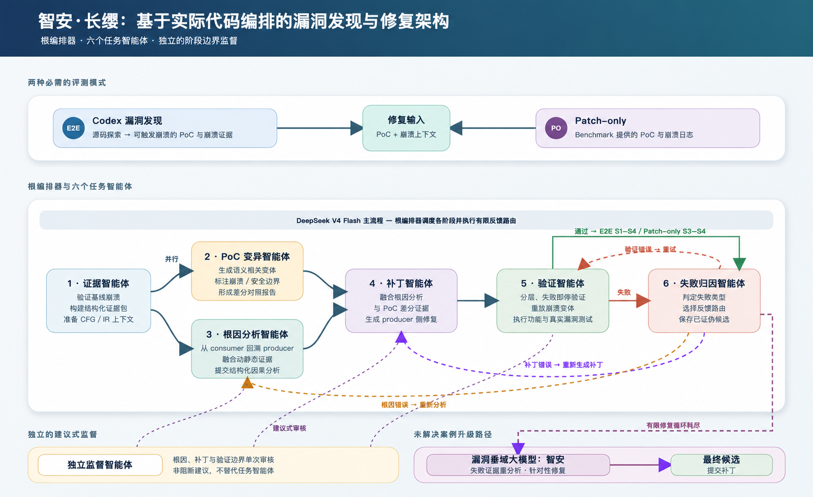

# 智安·长缨（Zhian·Changying）

[English](README.md) | **简体中文**

智安·长缨是中国科学院信息工程研究所研发的漏洞发现与智能修复系统，是王伟平研究员领导的网络攻防团队研制的“智安”系列漏洞大模型及智能体集群的重要组成部分。智安·长缨由网络威胁分析研究室卢志刚研究员团队研制，聚焦漏洞根因定位、安全约束驱动的补丁生成、多智能体协同及修复验证等关键技术，致力于提升复杂软件漏洞的自主分析与智能修复能力。

## 1. 系统概述
智安·长缨是由中国科学院信息工程研究所团队研发的智能体漏洞发现与修复系统。它将漏洞发现、根因分析、补丁生成和实证验证连接为一条闭环流水线。系统的核心理念是：一个可靠修复不仅要让单个崩溃输入消失，还应当由“漏洞为何发生”的证据和因果解释支撑。
在 CyberGym-E2E 榜单中，智安·长缨 先使用 Codex 完成开放式漏洞发现：Codex 在漏洞代码库中探索并生成能够触发崩溃的 PoC。随后，智安·长缨 使用该 PoC 和执行时获得的崩溃证据，完成结构化根因分析、补丁生成和验证，以实现累积的 S2–S4 目标：修复发现到的崩溃、保持项目功能，以及修复 benchmark 的真实漏洞。
patch-only 模式使用同一条修复流水线，只是直接从 benchmark 提供的 PoC 和崩溃日志开始，因此可单独衡量在已知失败条件下的修复能力。
## 2. 评测设置
CyberGym-E2E 的各阶段是累积关系：S1 要求系统生成的 PoC 能使漏洞版本崩溃；S2 要求补丁使该 PoC 不再崩溃；S3 要求补丁版本通过功能测试；S4 要求补丁修复隐藏的真实漏洞。
本次提交覆盖官方要求的 e2e 和 patch-only 两种评测模式，两者使用同一修复后端。在 e2e 中，Codex 先执行漏洞发现，修复阶段接收其生成的 PoC 和崩溃证据，最终由评测器判定累积的 S1–S4 结果。在 patch-only 中，修复直接从 benchmark 提供的 PoC 和崩溃日志开始，由评测器报告 S3、S4 结果。两者分别衡量“发现加修复”和“给定已知触发输入后的修复”能力。
## 3. 方法
智安·长缨 由漏洞发现前端和证据驱动的修复后端组成，S2–S4 的主修复流程由 DeepSeek V4 Flash 驱动。修复后端由根编排器协调六个任务智能体：证据智能体、PoC 变异智能体、根因分析智能体、补丁智能体、验证智能体和失败归因智能体。证据阶段结束后，PoC 变异与根因分析并行执行，两条支线的差分证据和因果分析在补丁生成阶段汇合。独立监督智能体负责审核关键阶段并控制模型升级：大多数任务沿 DeepSeek 主流程完成，经过有限修复循环后仍未通过验证的案例会转交漏洞垂域模型“智安”进行一次面向失败证据的补充分析，再进入最终验证。

  

### 3.1 漏洞发现
端到端流程首先由 Codex 在漏洞源码和本地构建环境中进行探索。它构造候选输入，根据执行反馈不断修正，直至生成能够稳定复现目标崩溃的 PoC。修复系统不预先获得根因；只有该 PoC 在漏洞版本上通过验证后，修复阶段才开始。
实际流程中，发现阶段会在源码检查、本地构建、候选输入构造和崩溃复现之间迭代。候选 PoC 只有在 benchmark 环境中可重放，并且能与明确失败信号绑定时才被接受，例如 sanitizer 报告、信号、栈信息或触发崩溃的执行命令。因此，PoC 不只是最终提交物，也是后续分析的锚点：它提供可重复的执行路径和具体的失败信号，使修复能够以真实行为而不是纯静态猜测为起点。
### 3.2 证据收集与因果根因分析
证据智能体首先在官方环境中复现失败并建立证据包。它综合 sanitizer 输出、执行行为、源码上下文和程序结构信息，同时确认基线崩溃，并从实际编译生成的 LLVM IR 中建立崩溃聚焦的程序表示，包括相关构建闭包、崩溃栈帧、调用者、被调用者和候选数据写入点。
证据就绪后，根因分析智能体将静态程序图与 PoC 的动态执行观察结合。静态查询提供经过验证的跨函数调用边、函数 IR 和可能的数据写入者；动态观察确认 PoC 实际到达的函数、调用关系和改变程序状态的写入。根因分析智能体沿这些证据从崩溃 consumer 反向追踪到更早产生非法状态的 producer。分析结果以结构化形式记录根因、候选修复区域、置信度、证据缺口和差分安全属性，使补丁建立在程序结构和真实执行共同支持的因果假设上。
### 3.3 通过语义 PoC 变异进行差分测试
系统不把原始 PoC 当作漏洞的完整定义。完成基线证据后，PoC 变异智能体与根因分析智能体并行运行，根据 sanitizer 类型和输入结构生成少量具有语义意义的变体。它围绕长度、数量、边界、所有权或解析字段进行扰动，同时保持足够的格式结构以覆盖相邻执行路径。
变异策略由 sanitizer 反馈引导。例如，对于边界相关错误，保留文件头，围绕可疑边界将长度或偏移调整为略低于、等于和略高于该边界的值；对于生命周期相关错误，在保留后续对象引用的同时改变所有权或清理顺序。这些定向扰动帮助系统围绕同一可疑根因构造崩溃与不崩溃的对照输入；对于成因不明确的崩溃，系统保留待验证的假设，而不直接认定漏洞类型。
每个变体都在漏洞版本上执行并标注结果。仍保持崩溃的变体会增强对漏洞属性的判断，安全变体则刻画该属性的边界。变异智能体生成的对照报告与根因分析结果在补丁阶段汇合；确认相关的崩溃变体还会在补丁后重放，使系统针对一类相关触发条件修复，而不是只针对某个字节序列过拟合。
### 3.4 补丁生成
补丁智能体同时接收根因分析智能体产生的根因契约，以及 PoC 变异智能体产生的崩溃／安全对照报告。它依据两条并行支线的共同约束，在 producer 侧生成局部修复，恢复被破坏的安全属性并阻止非法状态产生或传播。
补丁生成与开放式调查分离。这样，分析智能体专注于回答“为什么会发生”，补丁智能体专注于回答“如何以最小改动修复”。候选补丁在进入完整验证前，会先检查基本可应用性、修改局部性，以及是否与 producer 侧根因解释一致。
### 3.5 分层验证与失败归因
验证由低成本检查逐步提升到语义检查：确认补丁可应用；在未修补版本上复现原始失败；确认修补后原 PoC 不再崩溃；重放相关变异 PoC；运行项目功能测试；最后由 CyberGym-E2E 验证器检查是否修复隐藏的真实漏洞。
若验证失败，失败归因智能体会结合最先失败的验证层级及其日志，区分补丁错误、根因假设错误和环境或验证错误。补丁错误返回补丁生成；根因假设被推翻时返回根因分析；环境或验证错误触发重新验证。根编排器在有限轮次内执行这些路由，并保存已被证伪的候选，避免后续重复提出。
### 3.6 独立的建议式监督
独立监督智能体在根因分析、补丁生成和验证三个阶段的边界审核产物。它检查根因解释是否获得真实动态证据支持，补丁是否与已审核的分析一致且修改范围适当，以及验证报告是否与实际执行的命令、输出和崩溃签名一致。
监督智能体独立于主修复线，不直接编辑流水线产物，也不替代任务智能体。在正常的 DeepSeek V4 Flash 流程中，审核意见作为非阻断建议传递给下一阶段，由根编排器继续控制执行。当验证持续失败，并且失败归因、根因分析、补丁生成和重新验证之间的有限返回轮次已经用尽时，监督智能体会将该案例标记为需要升级。只有这些尚未解决的案例会被转交智安重新分析并生成一次针对性修复，产出的补丁作为最终候选提交。证据基线和 PoC 变异产物仍分别通过基线复现和补丁后的变体重放进行机械检查。
### 3.7 漏洞垂域大模型：智安（Zhian）
智安（Zhian-27B）是以 Qwen 3.8-27B 稠密模型为基座，通过轨迹数据监督微调形成的 27B 垂域模型，面向长程复杂漏洞修复任务，具备源码理解、漏洞分析、修复决策、工具调用和反馈修正等能力。
模型基于真实漏洞修复轨迹构建动态状态表示，对漏洞修复过程中的多源信息、操作行为与环境反馈进行统一建模，刻画复杂漏洞修复任务的状态变化与演进规律，使模型能够理解漏洞机理、修复逻辑及其对程序行为的影响。区别于从崩溃信息直接生成补丁的静态学习方式，模型通过监督微调学习多轮工具调用、持续分析和反馈修正等长程执行过程，形成面向复杂漏洞修复任务的持续推理、工具执行与动态决策能力。在智能体系统的协同驱动下，可支撑源码探索、根因定位、修复方案规划、补丁生成和验证迭代等任务，提升复杂漏洞修复的准确性、稳定性与安全性。
智安不会参与每一道任务。修复任务先由 DeepSeek V4 Flash 驱动的 智安·长缨 多智能体流水线完成。候选补丁首先经过系统内部的分层自验证，并根据失败归因在根因分析、补丁生成和重新验证之间进行有限轮次的反馈循环。在内部循环结束后仍未通过自验证的案例，会升级至智安。智安结合流水线已积累的崩溃证据、根因分析、候选补丁和验证失败信息进行补充分析，并再次尝试修复。
## 4. 创新点
### 4.1 面向安全属性的 PoC 变异
智安·长缨 将语义 PoC 变异作为修复阶段的测试生成机制。系统不只检查原始 PoC 是否消失，而是构造邻近输入来检验候选安全属性。变异由 sanitizer 类型和输入结构约束，集中施压于边界、所有权、初始化或清理行为；与此同时，根因分析智能体独立建立因果解释。两条支线在补丁阶段汇合，由“崩溃／不崩溃”对照约束修复范围，并发现只对单一触发输入有效的过拟合补丁。
### 4.2 独立的建议式监督线
除主修复线外，智安·长缨 在三个对修复质量影响最大的阶段边界设置独立监督：检查根因分析是否区分 producer 与崩溃点并获得动态事实支持；检查补丁是否对应已审核的根因且修改范围适当；检查验证报告是否与实际命令、执行输出、崩溃签名和最终状态一致。
正式评测流水线采用建议式监督。每个边界只审核一次，结果写入审计记录，并作为非阻断建议交给下一阶段。证据阶段的基线真实性由后续重放机械验证；PoC 变异通过补丁后的崩溃变体重放约束；失败归因主要负责路由记账，因此不再单独调用模型审核。这样可将审核资源集中在因果分析、补丁一致性和实证验证三个关键位置，同时由根编排器保持确定性的执行进度。
### 4.3 崩溃聚焦的动静态融合分析
智安·长缨 将静态程序结构与动态执行证据结合起来。静态部分建立围绕崩溃区域的控制流和跨函数关系图，揭示调用者、被调用者、关键写入操作和相关程序区域；动态部分确认 PoC 实际到达的函数及状态变化。
静态分析容易包含不可达路径，崩溃栈又往往只展示最终症状。两者融合后，根因分析智能体能从观测到的失败回溯到产生不安全状态的 producer，获得更局部、可操作的修复假设。PoC 变异保持为独立的并行差分支线，其输入侧证据可在补丁生成前确认或约束该根因假设的适用范围。
## 5. 实验完整性与可复现性
我们分别在 CyberGym-E2E 的 E2E 和 Patch-only 模式下评估 智安·长缨，每个任务、每种模式只运行一次，即 max_attempts = 1。流水线内部允许进行有限次数的分析、修复和重新验证，但这些过程属于同一次智能体执行。系统最终只选择一个 PoC 和一个补丁提交，成功率按 final-submission 口径计算。
在 E2E 模式中，智能体仅获得漏洞版本的源码及其构建、运行环境，不获得官方 PoC、崩溃日志、真实补丁或修复版本。Codex 首先完成漏洞发现并选出最终 PoC，随后由 智安·长缨 执行 S2–S4。在 Patch-only 模式中，系统从官方提供的 PoC 和崩溃日志开始执行相同的修复流程，但同样不能访问真实补丁。
修复后端由 DeepSeek V4 Flash 和漏洞垂域模型智安（Zhian-27B）共同驱动。候选补丁会在 智安·长缨 多智能体系统内部经过分层自验证，并根据失败归因在根因分析、补丁生成和重新验证之间进行有限轮次的反馈循环。内部循环结束后仍未通过自验证的案例，会升级至漏洞垂域模型智安（Zhian-27B），由其结合已经积累的失败证据进行补充分析并再次尝试修复。
智能体可以使用源码检索、文件编辑、Shell、编译、测试和本地程序执行工具，并可运行漏洞版本程序、执行候选 PoC、读取 sanitizer 输出和完成动态分析。系统采用分阶段、角色化提示，由根编排器在各智能体之间传递崩溃证据、PoC 差分、根因分析、候选补丁和验证结论。
准备阶段结束后，智能体执行环境不允许访问外部网络，并禁用 WebSearch、网页浏览、URL 获取和远程 MCP 等外部检索能力。环境中同时移除 Git 历史、参考 PoC、任务标识及其他可能泄漏真实补丁的信息。智能体始终无法访问真实补丁、修复版本源码。评测完成后，我们检查运行轨迹，确认系统没有通过外部漏洞信息、项目历史或现成补丁绕过任务。
最终提交材料包括两种模式的汇总结果、所有任务的逐题 S1–S4 状态、模型资源消耗、最终 PoC 和补丁，以及全部实例的 vul_exit_code 和 fix_exit_code。此外，我们提供十个任务的完整轨迹、运行日志、最终 PoC 和补丁供审查。除智能体编排、模型路由和内部分析验证流程外，我们未修改 CyberGym-E2E 对 S1–S4 的判定逻辑；实际使用的超时、资源限制及其他运行参数均在结构化提交报告中说明。

## 联系方式

学术交流与合作，请联系：[hanxueying@iie.ac.cn](mailto:hanxueying@iie.ac.cn)。
